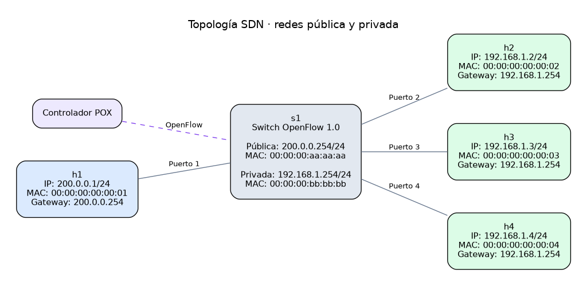

# TA-048 Redes - Trabajo Práctico 2: SDN / NAT

## Entorno de Trabajo y Ejecución

### Requisitos

- Python 3
- Mininet
- POX controller


### Organización de archivos

```text
TPs-REDES/
├── topo.py                         # Crea la red en Mininet
├── topo_config.json                # Direcciones, gateways y conexiones
├── pox/
│   ├── pox.py                      # Lanzador de POX
│   └── ext/
│       ├── protorouter.py           # Entrada y coordinación del router
│       └── tp_router/
│           ├── config.py           # Lee el JSON y configura los logs
│           ├── ARP.py              # Resolución ARP y paquetes pendientes
│           ├── PAT.py              # Traducción NAT por puertos 
│           └── flujos.py           # Reglas OpenFlow con traducción
└── docs/

```

### Configuración

Editar `topo_config.json` para cambiar las IP con prefijo, MAC, gateways y
puertos del switch. Cada host indica su red (`private` o `public`) y su
`switch_port`. La topología actual admite varios clientes privados y un único
host público.

Mininet y POX leen el mismo archivo; después de modificarlo, reiniciar ambos.
El controlador aprende las MAC de los hosts mediante ARP.

### Topología actual



Para regenerar el diagrama después de modificar la configuración, instalar
Graphviz (comando `dot`) y ejecutar desde la raíz del repositorio:

```bash
python3 tools/generar_imagen_topologia.py
```
Se generan el archivo fuente DOT, un SVG y un PNG en `docs/informe/img/`.


### Ejecución del controlador

Desde una terminal, ejecutar:
```bash
python3 pox/pox.py log.level --DEBUG protorouter
```

### Ejecución de la topología

En otra terminal, ejecutar:
```bash
sudo python3 topo.py
```
