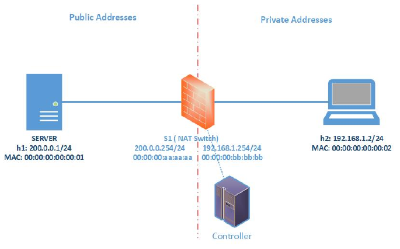
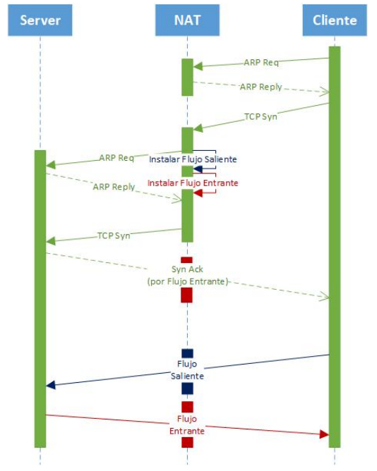

# Trabajo Práctico N° 2: SDN - NAT

Redes (TA048) / Introducción a los Sistemas Distribuidos (75.43)  
Facultad de Ingeniería, Universidad de Buenos Aires

27 de octubre de 2026

## 1. SDN: Implementación de NAT con POX y Mininet

### 1.1. Objetivos

El objetivo de este trabajo práctico es que los alumnos:

- Comprendan el paradigma de Redes Definidas por Software (SDN) y la separación entre plano de control y plano de datos.
- Analicen cómo un controlador SDN puede implementar funcionalidades de red mediante la instalación de reglas en switches OpenFlow.
- Implementen lógica de procesamiento de paquetes en un controlador utilizando POX.
- Utilicen Mininet para emular una red y validar su implementación.
- Diseñen e implementen un **NAT saliente con traducción por puertos (PAT)** como aplicación sobre SDN.

### 1.2. Descripción general

En el contexto de SDN, el comportamiento de la red es definido por un controlador que interactúa con los dispositivos de forwarding mediante OpenFlow.

En este trabajo práctico, la cátedra provee una topología inicial de red en Mininet y un controlador POX con funcionalidad básica de forwarding[^1].

El controlador provisto funciona como base sobre la cual se implementará la solución, extendiendo la lógica existente.

A partir de estos elementos, se deberá extender tanto la topología como el controlador, agregando la lógica necesaria para implementar un NAT saliente con traducción por puertos.

El objetivo es que el controlador implemente la lógica de traducción, el mantenimiento de estado, y la instalación de reglas OpenFlow. Una vez instaladas las reglas correspondientes, el procesamiento normal de los paquetes deberá realizarse en el switch, minimizando la intervención posterior del controlador.

## 2. Topología de Trabajo

La red inicial está compuesta por:

- Un host en la red pública (servidor).
- Un switch OpenFlow controlado por POX.
- Un host en la red privada (cliente inicial).
- El switch actúa como un dispositivo de capa 3 con dos interfaces:



*Figura 1: Topología Base*

| | IP | MAC |
| --- | --- | --- |
| Interfaz Pública | 200.0.0.254 | 00:00:00:aa:aa:aa |
| Interfaz Privada | 192.168.1.254 | 00:00:00:bb:bb:bb |

## 3. Controlador

Se provee un controlador básico que implementa solo las siguientes funcionalidades:

- Procesamiento de paquetes IPv4.
- Detección de tráfico proveniente de la red privada.
- Reescritura de direcciones MAC para permitir la comunicación entre redes.
- Instalación de reglas de forwarding en el switch para minimizar la intervención posterior del controlador.

El dispositivo implementado no realiza routing basado en tablas de enrutamiento, sino forwarding mediante reglas instaladas dinámicamente por el controlador.

### Limitaciones

El controlador provisto no implementa las siguientes funcionalidades:

- Protocolo ARP.
- Traducción de direcciones IP.
- Soporte para múltiples hosts privados.
- Manejo de puertos de transporte (TCP/UDP).
- Mantenimiento del estado de las conexiones.

## 4. Propuesta de Trabajo

### 4.1. Objetivo

A partir del controlador provisto, se deberá implementar un **NAT saliente con traducción por puertos (PAT)**.

El sistema final deberá permitir que múltiples hosts de la red privada:

- Se comuniquen con la red pública.
- Compartan una única dirección IP pública.
- Mantengan múltiples conexiones simultáneas.

### 4.2. Flujo

El comportamiento esperado se describe a nivel general en la siguiente figura:



*Figura 2: Flujo de paquetes a través del NAT*

- Un host privado inicia una conexión hacia un host público.
- El NAT:
  - Traduce direcciones (IP y puertos) y reescribe direcciones MAC.
  - Reenvía el paquete hacia la red pública.
- El host público responde.
- El NAT:
  - Identifica la conexión correspondiente.
  - Traduce dirección IP y puerto de destino.
  - Reenvía el paquete hacia el host privado correcto.

### 4.3. Requisitos funcionales

El sistema final debe:

- Permitir comunicación desde múltiples hosts privados hacia la red pública.
- Soportar tráfico TCP y UDP.
- Resolver direcciones MAC mediante ARP dinámico.
- Mantener estado de las conexiones activas.
- Traducir correctamente paquetes en ambos sentidos.

## 5. Entorno de Trabajo y Ejecución

### 5.1. Requisitos

Para la realización del trabajo práctico se requiere:

- Python 3
- Mininet
- POX controller

### 5.2. Instalación de POX

Clonar el repositorio oficial[^2]

### 5.3. Ubicación del controlador

El archivo del controlador provisto (`protorouter.py`) debe ubicarse en el directorio `pox/ext/`

### 5.4. Ejecución del controlador

Desde una terminal, ejecutar:

```bash
python3 pox/pox.py [log.level --DEBUG] protorouter
```

### 5.5. Ejecución de la topología

En otra terminal, ejecutar:

```bash
sudo python3 topo.py
```

### 5.6. Orden de ejecución recomendado

1. Iniciar el controlador POX.
2. Ejecutar la topología en Mininet.
3. Verificar que el switch se conecte al controlador.

### 5.7. Verificación básica

- Iniciar la red.
- Abrir la CLI de Mininet.
- Probar conectividad: `h2 ping h1`

## 6. Tareas a Realizar

### 6.1. Extensión de la topología

Modificar la topología provista:

- Agregar hosts en la red privada.
- Verificar conectividad básica utilizando el controlador provisto.
- Eliminar cualquier configuración de ARP estático.

### 6.2. Manejo de ARP

Extender el controlador para:

- Responder ARP Requests dirigidas a las IP del dispositivo.
- Generar ARP Requests cuando sea necesario resolver direcciones MAC.
  - Debe resolverse tanto la MAC de hosts privados como la del servidor público.
  - No deben existir entradas ARP estáticas en ningún host.
- Mantener una tabla ARP dinámica.

Este componente es necesario para que el NAT pueda resolver direcciones MAC en ambas redes.

### 6.3. NAT por puertos (PAT)

Extender la implementación para permitir múltiples conexiones simultáneas:

- Traducir:
  - Dirección IP origen
  - Puerto origen (TCP/UDP)
- Mantener una o más tablas de traducción para identificar cada conexión.

| Protocolo | IP privada | Puerto privado | IP pública | Puerto público |
| --- | --- | --- | --- | --- |

*Cuadro 1: Ejemplo Conceptual*

- Asignar puertos públicos disponibles.
- Evitar colisiones entre conexiones.
- Reutilizar recursos cuando sea posible.

Será necesario inspeccionar encabezados de capa de transporte (TCP/UDP) para identificar correctamente las conexiones.

### 6.4. Instalación de flujos

El switch deberá encargarse del forwarding de paquetes una vez establecida la traducción.

Se espera:

- Instalación de reglas para tráfico:
  - Saliente
  - Entrante
- Minimizar la cantidad de paquetes que llegan al controlador.
- Uso de timeouts apropiados para liberar recursos.

El controlador solo deberá intervenir ante nuevos flujos, expiraciones de estado o eventos que requieran la resolución de ARP. El tráfico correspondiente a conexiones ya establecidas deberá ser procesado por el switch usando las reglas OpenFlow ya instaladas, minimizando la intervención posterior del controlador.

## 7. Entrega

### 7.1. Entregables

1. Código
   - Script de topología actualizado.
   - Controlador POX modificado.
2. Informe (PDF)

   Debe incluir:

   - Descripción general de la solución.
   - Diseño de la tabla NAT.
   - Manejo de ARP.
   - Estrategia de instalación de flujos.
   - Decisiones de diseño.
   - Problemas encontrados y soluciones implementadas.
   - Pruebas realizadas:
     - Conectividad básica
     - Múltiples clientes
     - Diferentes tipos de tráfico
   - Conclusión.

### Consideraciones adicionales

- La topología y el controlador provistos deben ser utilizados como punto de partida.
- Se recomienda:
  - Trabajar en forma incremental partiendo del código entregado.
  - Validar el funcionamiento utilizando herramientas como:
    - wireshark
    - iperf
    - tcpdump

### 7.2. Fecha de Entrega

La entrega se hará a través del campus. La fecha de entrega está pautada para el día martes 17 de Noviembre de 2026 a las 19.00hs. Cualquier entrega fuera de término no será considerada.

### 7.3. Demostración

Durante la demo se deberá:

- Modificar direcciones IP y/o MAC en la topología para verificar que la solución no dependa de valores hardcodeados.
- Efectuar pruebas que muestren el funcionamiento del NAT con múltiples conexiones simultáneas.
- Explicar el funcionamiento interno del controlador.

[^1]: https://github.com/TA048/tp_sdn_nat
[^2]: https://github.com/noxrepo/pox.git
