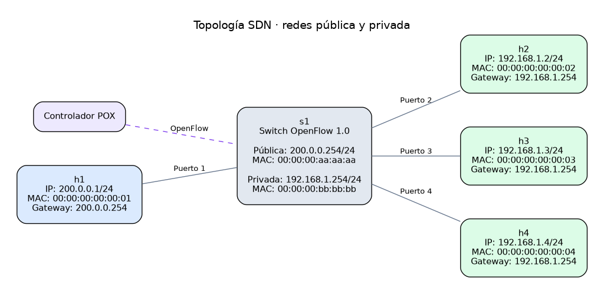

# Informe del TP: SDN y NAT

## Descripción general de la solución

## Diseño de la tabla NAT

`PAT.py` mantiene dos diccionarios, uno por sentido de búsqueda:

```text
salientes: (protocolo, ip_privada, puerto_privado) -> puerto_publico
entrantes: (protocolo, puerto_publico) -> (protocolo, ip_privada, puerto_privado)
```

Ambas búsquedas son O(1), y el valor de cada diccionario permite llegar a la entrada del otro. No guardamos la IP pública por fila porque es una sola: la de `gateways.public`.

Los puertos públicos salen del rango dinámico de la IANA (49152-65535). Hay una lista de puertos libres por protocolo, porque TCP y UDP tienen espacios independientes y pueden usar el mismo número. Asignar y liberar son O(1) (`pop` y `append`). Si no quedan puertos, `obtener_puerto` devuelve `None` y no se instala ninguna regla.

## Manejo de ARP

El controlador implementa un manejo propio de ARP para comportarse como router entre la red privada y la red pública. El protocolo ARP se utiliza en dos situaciones principales:

* Para responder a los hosts que preguntan por la IP del router.
* Para resolver dinámicamente la MAC de los hosts públicos antes de reenviar tráfico hacia ellos.

En nuestra solución, el switch tiene dos interfaces:

```text
IP privada del router: 192.168.1.254
MAC privada del router: 00:00:00:bb:bb:bb

IP pública del router: 200.0.0.254
MAC pública del router: 00:00:00:aa:aa:aa
```

Estas direcciones representan al router en cada lado de la red. Para los hosts privados, el gateway es `192.168.1.254`, mientras que para los hosts públicos es el `200.0.0.254`.

### 1. Tabla ARP

La tabla ARP está administrada en el controlador mediante el diccionario `arp_table`. Su objetivo es guardar las asociaciones entre direcciones IP y direcciones MAC aprendidas en tiempo de ejecución.

Conceptualmente, la tabla tiene la siguiente estructura:

```text
IP -> (MAC, última vez visto)

192.168.1.2 -> (00:00:00:00:00:02, 1730000000.0)
200.0.0.1   -> (00:00:00:00:00:01, 1730000004.2)
```

#### ¿Cuándo se actualiza la tabla ARP?

El controlador actualiza la `arp_table` en dos momentos:

1. **Al recibir un `ARP REQUEST`:** Cuando un host de la red envía una consulta ARP preguntando por la IP del gateway (por ejemplo, h2 buscando la MAC de 192.168.1.254), la trama pasa por el controlador. En ese instante, el método handle_arp inspecciona los campos del emisor (protosrc y hwsrc) e inserta de forma inmediata esa IP y MAC en la arp_table. Este mecanismo permite aprender las direcciones de los hosts locales sin costo adicional y sin necesidad de emitir peticiones adicionales por la red.
2. **Al recibir un `ARP REPLY`:** Cuando un paquete IP tiene como destino una dirección MAC desconocida, el controlador genera y emite una solicitud ARP REQUEST proactiva hacia la red pública. Cuando el host de destino responde mediante una trama ARP REPLY, el controlador intercepta el mensaje en la rama correspondiente de handle_arp, extrae la asociación (IP → MAC) y la registra en la arp_table. Inmediatamente después de actualizar la tabla, el controlador utiliza esta entrada para despachar los paquetes que se encontraban retenidos en el buffer.

#### Vencimiento de entradas

Cada entrada vence si pasan más de `ARP_TIMEOUT = 20` s (`config.py`) sin ver un ARP de esa IP. Cada ARP visto la refresca.

El vencimiento se evalúa en `resolve_mac`: si la entrada venció, se borra, se loguea `ARP VENCIDO` y se trata como desconocida (se retiene el paquete y se envía un `ARP REQUEST`). No usamos un `Timer`: con pocos hosts alcanza con revisar la entrada al consultarla.

El valor se eligió para el entorno de prueba: es mayor que el `idle_timeout` de los flujos (10 s) y lo bastante corto para ver el vencimiento en una demo. Los dos timeouts son independientes: con un flujo instalado, el switch reenvía sin consultar al controlador.

No hay reintentos de `ARP REQUEST` ni timeout para `packet_buffer`.

### 2. Retención de paquetes pendientes

Mientras el controlador espera el `ARP REPLY` de un host externo, no descarta el paquete IP original. En su lugar, retiene el evento OpenFlow en el diccionario `packet_buffer`.

El `packet_buffer` se representa como:

```text
IP destino -> lista de eventos pendientes

200.0.0.1 -> [pending_event_1, pending_event_2]
```

#### Manejo de consultas (`resolve_mac`)

1. **Petición única:** Al llegar el primer paquete para una IP desconocida, se guarda en el buffer y se envía un `ARP REQUEST` broadcast (`Who has X? Tell 200.0.0.254`).
2. **Evitar solicitudes duplicadas:** Si llegan nuevos paquetes hacia la misma IP antes de recibir la respuesta, se encolan en la lista de la IP correspondiente sin reenviar otro paquete ARP.
3. **Despacho de tráfico:** Al recibir el `ARP REPLY`, se registra la MAC en `arp_table`, se procesan e instalan las reglas de flujo para todos los eventos retenidos de esa IP, y finalmente se elimina la entrada del buffer.

## Estrategia de instalación de flujos

Cada conexión TCP o UDP nueva llega al controlador como `PacketIn`. `flujos.py` instala dos reglas y reenvía el primer paquete, ya traducido, con un `PacketOut`. El tráfico siguiente lo procesa el switch.

| Sentido | Campos de coincidencia | Acciones |
| --- | --- | --- |
| Saliente | IPv4, protocolo, puerto del cliente en el switch, IP y puerto privados, IP y puerto del servidor | MAC origen pública, MAC destino del servidor, IP origen pública, puerto origen público, salida por el puerto público |
| Entrante | IPv4, protocolo, puerto público del switch, IP y puerto del servidor, IP y puerto públicos | MAC origen privada, MAC destino del cliente, IP y puerto destino privados, salida por el puerto del cliente |

Las reglas usan `idle_timeout = 10` y el flag `OFPFF_SEND_FLOW_REM`, para que el switch avise con un `FlowRemoved` cuando las borra. En la regla entrante, el puerto público está en `tp_dst`. En la saliente hay que buscarlo en `salientes`: el `match` describe el paquete antes de traducirse, y el `FlowRemoved` no incluye las acciones.

## Decisiones de diseño

### Organización de archivos

Separamos el controlador por responsabilidad para poder trabajar sobre ARP, PAT y las reglas sin concentrar todo en `protorouter.py`.

```text
TPs-REDES/
├── topo.py                         # Crea la red en Mininet
├── topo_config.json                # Direcciones, gateways y conexiones
├── pox/
│   ├── pox.py                      # Lanzador de POX
│   └── ext/
│       ├── protorouter.py           # Entrada y coordinación del router
│       └── tp_router/
│           ├── config.py           # Lee el JSON y configura los logs
│           ├── ARP.py              # Resolución ARP y paquetes pendientes
│           ├── PAT.py              # Traducción NAT por puertos 
│           └── flujos.py           # Reglas OpenFlow con traducción
```

- **`protorouter.py`:** punto de entrada del controlador. Registra los eventos OpenFlow y coordina el procesamiento de paquetes con los módulos de ARP y flujos.
- **`config.py`:** lee `topo_config.json`, convierte las direcciones a los tipos de POX y define los valores compartidos del router. También configura el logger y los colores de sus mensajes.
- **`ARP.py`:** administra la tabla ARP, responde consultas por las IP del router y genera solicitudes para resolver las MAC de los hosts. Retiene los paquetes que esperan una resolución ARP.
- **`PAT.py`:** administra las tablas de traducción y la asignación de puertos públicos para identificar las conexiones de los clientes privados.
- **`flujos.py`:** construye e instala las reglas OpenFlow de salida y retorno, y reenvía el primer paquete de cada flujo.
- **`topo.py`:** crea los hosts, el switch y sus enlaces en Mininet a partir de `topo_config.json`.
- **`topo_config.json`:** define las IP, MAC, gateways y puertos del switch que utilizan la topología y el controlador.

### Configuración y topología

Centralizamos las direcciones y conexiones en [`topo_config.json`](../../topo_config.json) para que Mininet y POX usen los mismos valores. Esto evita duplicarlos en el código y permite cambiar la topología desde un solo archivo.

En `gateways` se definen la IP con prefijo y la MAC de las interfaces pública y privada del NAT. En `hosts`, cada equipo indica su nombre, IP con prefijo, MAC, red (`private` o `public`) y puerto del switch (`switch_port`). Para agregar un cliente, se añade una entrada con IP, MAC y puerto libres. La configuración actual admite varios clientes privados y un único enlace público.

Después de editar el JSON, hay que reiniciar Mininet y POX. Para actualizar el diagrama, se ejecuta `python3 tools/generar_imagen_topologia.py` desde la raíz del repositorio.

### Traducción en `flujos.py`

La consulta a `PAT` está en `process_ip_with_destination_mac` y no en `handle_ip`, porque los paquetes retenidos por ARP vuelven directamente a esa función. Es el único paso común a todos los paquetes salientes.

### Liberación de puertos

Cada conexión tiene dos reglas, y cada una vence según el tráfico de su sentido. En UDP en un solo sentido, la regla sin tráfico vence mientras la otra sigue en uso. Si el puerto se liberara con el primer aviso, otra conexión podría recibirlo.

Por eso `self.reglas` guarda los sentidos con regla activa de cada conexión, y el puerto se libera cuando vencieron los dos. Usamos un set en lugar de un contador porque, al reinstalar las reglas de una conexión, la que seguía activa se reemplaza sin aviso: un contador se desfasaría.

## Problemas encontrados y soluciones implementadas

### Liberación prematura de puertos

Liberar el puerto con el primer `FlowRemoved` permitía reasignarlo mientras la otra regla seguía activa. Se resolvió con `self.reglas`, descripto en [Liberación de puertos](#liberación-de-puertos).

### Límites actuales (sin resolver)

- **ICMP:** OpenFlow 1.0 no puede matchear ni reescribir el identificador de ICMP, así que los pings no se traducen con reglas. El controlador descarta lo que no sea TCP o UDP, y por eso `h2 ping h1` no responde.
- **Regla entrante vencida:** `handle_ip` descarta lo que llega de la red pública sin regla, aunque la conexión siga en la tabla. En UDP, si la vuelta llega después de 10 s sin tráfico entrante, se pierde.
- **Un puerto privado hacia varios destinos:** las reglas se registran por puerto público, no por destino. Si un socket UDP habla con dos destinos a la vez, el puerto podría liberarse antes de tiempo.

## Pruebas realizadas

Las pruebas se hicieron en Mininet, con `iperf` en `h1` como servidor.

### Conectividad básica

Conexión TCP de `h2` a `h1` durante 5 s:

```text
mininet> h2 iperf -c 200.0.0.1 -t 5
[  1] local 192.168.1.2 port 50462 connected with 200.0.0.1 port 5001
[  1] 0.0000-5.0075 sec  15.7 GBytes  27.0 Gbits/sec
```

```text
mininet> h1 cat /tmp/tcp.log
[  1] local 200.0.0.1 port 5001 connected with 200.0.0.254 port 65535
[  1] 0.0000-5.0011 sec  15.7 GBytes  27.0 Gbits/sec
```

`h2` usa su IP y puerto privados, y `h1` ve la conexión desde la IP pública y el puerto 65535, el primero asignado.

`h2 ping h1` no responde con la versión actual: ver [Límites actuales](#límites-actuales-sin-resolver).

### Múltiples clientes
Para probar múltiples clientes se agregaron a la topología inicial los hosts `h3` y `h4`, en la misma red privada que `h2`.



| Host | Red | IP | MAC | Gateway | Puerto de s1 |
| --- | --- | --- | --- | --- | --- |
| h1 | Pública | 200.0.0.1/24 | 00:00:00:00:00:01 | 200.0.0.254 | 1 |
| h2 | Privada | 192.168.1.2/24 | 00:00:00:00:00:02 | 192.168.1.254 | 2 |
| h3 | Privada | 192.168.1.3/24 | 00:00:00:00:00:03 | 192.168.1.254 | 3 |
| h4 | Privada | 192.168.1.4/24 | 00:00:00:00:00:04 | 192.168.1.254 | 4 |

Conexiones TCP simultáneas de `h2` y `h3` hacia `h1`, durante 15 s:

```text
mininet> h2 iperf -c 200.0.0.1 -t 15 &
mininet> h3 iperf -c 200.0.0.1 -t 15 &
mininet> sh ovs-ofctl dump-flows s1
tcp,in_port="s1-eth2",nw_src=192.168.1.2,nw_dst=200.0.0.1,tp_src=36554,tp_dst=5001 actions=mod_dl_src:00:00:00:aa:aa:aa,mod_dl_dst:00:00:00:00:00:01,mod_nw_src:200.0.0.254,mod_tp_src:65535,output:"s1-eth1"
tcp,in_port="s1-eth1",nw_src=200.0.0.1,nw_dst=200.0.0.254,tp_src=5001,tp_dst=65535 actions=mod_dl_src:00:00:00:bb:bb:bb,mod_dl_dst:00:00:00:00:00:02,mod_nw_dst:192.168.1.2,mod_tp_dst:36554,output:"s1-eth2"
tcp,in_port="s1-eth3",nw_src=192.168.1.3,nw_dst=200.0.0.1,tp_src=55954,tp_dst=5001 actions=mod_dl_src:00:00:00:aa:aa:aa,mod_dl_dst:00:00:00:00:00:01,mod_nw_src:200.0.0.254,mod_tp_src:65534,output:"s1-eth1"
tcp,in_port="s1-eth1",nw_src=200.0.0.1,nw_dst=200.0.0.254,tp_src=5001,tp_dst=65534 actions=mod_dl_src:00:00:00:bb:bb:bb,mod_dl_dst:00:00:00:00:00:03,mod_nw_dst:192.168.1.3,mod_tp_dst:55954,output:"s1-eth3"
```

Se instalaron cuatro reglas: dos por conexión, con un puerto público distinto para cada cliente. Los contadores del switch (más de 100000 paquetes por regla) muestran que el tráfico no pasa por el controlador.

Sin tráfico, `dump-flows` quedó vacío. Una conexión posterior de `h4` reutilizó un puerto liberado:

```text
mininet> h1 cat /tmp/tcp.log
[  2] local 200.0.0.1 port 5001 connected with 200.0.0.254 port 65535
[  3] local 200.0.0.1 port 5001 connected with 200.0.0.254 port 65534
[  2] 0.0000-15.0013 sec  40.8 GBytes  23.4 Gbits/sec
[  3] 0.0000-15.0004 sec  38.3 GBytes  21.9 Gbits/sec
[  4] local 200.0.0.1 port 5001 connected with 200.0.0.254 port 65534
[  4] 0.0000-3.0009 sec  11.0 GBytes  31.5 Gbits/sec
```

La conexión de `h2` también usó el 65535, el mismo puerto de la prueba de conectividad básica.

### Diferentes tipos de tráfico

**TCP:** ver las pruebas anteriores.

**UDP:** `h2` envió datagramas a `h1` en un solo sentido durante 15 s:

```text
mininet> h2 iperf -c 200.0.0.1 -u -t 15
[  1] local 192.168.1.2 port 59809 connected with 200.0.0.1 port 5001
[  1] 0.0000-15.0177 sec  1.88 MBytes  1.05 Mbits/sec
[  1] Sent 1342 datagrams
[  3] WARNING: did not receive ack of last datagram after 10 tries.
mininet> h1 cat /tmp/udp.log
[  1] local 200.0.0.1 port 5001 connected with 200.0.0.254 port 65535
[  1] 0.0000-15.0060 sec  1.88 MBytes  1.05 Mbits/sec   0.085 ms 0/1341 (0%)
```

`h1` recibió el tráfico desde la IP pública, con un solo puerto durante toda la prueba y sin pérdidas. Al terminar, `dump-flows` mostraba solo la regla saliente: la entrante había vencido sin liberar el puerto.

El warning corresponde al ACK final de iperf, que en esta prueba no volvió a `h2`. En una prueba de 3 s, con la regla entrante todavía activa, no aparece y `h2` recibe el reporte del servidor. Es consistente con el límite de [regla entrante vencida](#límites-actuales-sin-resolver).

Para descartar pérdidas en el NAT, se capturó una prueba de 3 s con `tcpdump` en ambos extremos: `h2` envió 271 datagramas hacia `h1`, `h1` recibió 271, y todos miden 1470 bytes.

## Conclusión
