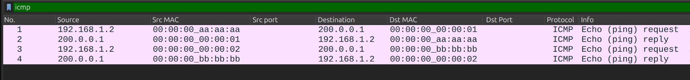
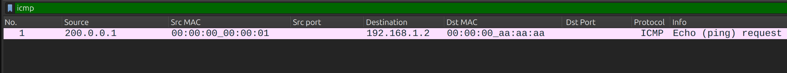

# Informe del estado inicial del repositorio

Este documento describe la base provista en `topo.py` y `pox/ext/protorouter.py`, antes de implementar el NAT con traducción por puertos (PAT).

## Topología actual

La red emulada con Mininet tiene dos hosts conectados al switch OpenFlow `s1`, controlado por POX:

| Host | Red | IP | MAC | Gateway | Puerto de s1 |
| --- | --- | --- | --- | --- | --- |
| h1 | Pública | 200.0.0.1/24 | 00:00:00:00:00:01 | 200.0.0.254 | 1 |
| h2 | Privada | 192.168.1.2/24 | 00:00:00:00:00:02 | 192.168.1.254 | 2 |

El dispositivo simula una interfaz pública con MAC `00:00:00:aa:aa:aa` y una privada con MAC `00:00:00:bb:bb:bb`. El controlador define el forwarding mediante reglas OpenFlow 1.0; no utiliza una tabla de rutas IP. IPv6 se deshabilita al iniciar la topología.

## Manejo de ARP

La topología configura entradas ARP estáticas en ambos hosts para asociar la IP de su gateway con la MAC correspondiente. Además, el controlador tiene fija la MAC de h1.

No hay resolución ARP dinámica: POX ignora los paquetes que no sean IPv4. Las direcciones de gateway declaradas en el controlador no se utilizan para responder consultas ARP.

## Flujos actuales del controlador

Ante un paquete IPv4 sin regla que llega mediante un `PacketIn`, POX verifica si la IP de origen pertenece a `192.168.1.0/24`. Si pertenece, instala dos reglas:

| Sentido | Campos de coincidencia | Acciones |
| --- | --- | --- |
| Saliente | IPv4, IP origen del cliente y puerto de entrada | MAC origen pública, MAC destino de h1 y salida por puerto 1 |
| Entrante | IPv4, IP origen del servidor, IP destino del cliente y puerto de entrada 1 | MAC origen privada, MAC destino del cliente y salida por su puerto |

El primer paquete se reenvía con las MAC modificadas mediante un `PacketOut`. Los siguientes se procesan en el switch con las reglas instaladas. Cada regla expira tras 10 segundos sin coincidencias (`idle_timeout=10`).

Si el origen no pertenece a la red privada, el controlador no instala reglas ni reenvía el paquete. Esto no afecta a los paquetes entrantes que ya coinciden con una regla del switch.

## Alcance y limitaciones

La base reescribe direcciones Ethernet, pero conserva las IP y los puertos de transporte: **todavía no implementa NAT/PAT**.

Las reglas no distinguen TCP, UDP ni conexiones individuales. La saliente tampoco filtra por IP destino y siempre utiliza la MAC fija de h1. La entrante permite cualquier paquete IPv4 que coincida con sus campos, sin comprobar que sea una respuesta de una conexión activa. Por eso, no equivale a un seguimiento de conexiones.

La topología actual incluye un único cliente privado. No hay tabla de traducciones, asignación de puertos públicos ni resolución dinámica de las MAC.

## Pruebas realizadas

### Preparación

Desde la raíz del repositorio, iniciar POX y luego Mininet en otra terminal:

```bash
python3 pox/pox.py log.level --DEBUG protorouter
```

```bash
sudo python3 topo.py
```

Con la topología activa, en Wireshark capturar ambos lados del switch, `s1-eth1` y `s1-eth2` (seleccionar ambos manteniendo Ctrl), y aplicar el filtro `icmp`. Agregar columnas personalizadas para MAC origen (`eth.src`) y MAC destino (`eth.dst`).

### Ping desde el host privado hacia el público

**Mininet**

```bash
mininet> h2 ping -c 1 h1
PING 200.0.0.1 (200.0.0.1) 56(84) bytes of data.
64 bytes from 200.0.0.1: icmp_seq=1 ttl=64 time=1.06 ms

--- 200.0.0.1 ping statistics ---
1 packets transmitted, 1 received, 0% packet loss, time 0ms
rtt min/avg/max/mdev = 1.064/1.064/1.064/0.000 ms
```

**POX**

```bash
INFO:protorouter:Iniciando ProtoRouter para Switch 1
INFO:protorouter:RECIBIDO: 192.168.1.2 → 200.0.0.1 | MAC: 00:00:00:00:00:02 → 00:00:00:bb:bb:bb | In Port: 2
INFO:protorouter:MATCH: 192.168.1.2 pertenece a la red privada 192.168.1.0/24
INFO:protorouter:ENVIANDO: 192.168.1.2 → 200.0.0.1 | MAC: 00:00:00:aa:aa:aa → 00:00:00:00:00:01 | Out Port: 1
```

**Wireshark**



Mininet confirma una respuesta sin pérdida de paquetes. POX recibe la solicitud por el puerto 2, reconoce el origen privado (`MATCH`) y la reenvía por el puerto 1 con las MAC modificadas.

Wireshark muestra la solicitud y la respuesta en ambos enlaces: cuatro registros para un único intercambio ICMP. Las filas corresponden a:

| Fila | Tramo | MAC origen → destino |
| --- | --- | --- |
| 3 | h2 → s1 | 00:00:00:00:00:02 → 00:00:00:bb:bb:bb |
| 1 | s1 → h1 | 00:00:00:aa:aa:aa → 00:00:00:00:00:01 |
| 2 | h1 → s1 | 00:00:00:00:00:01 → 00:00:00:aa:aa:aa |
| 4 | s1 → h2 | 00:00:00:bb:bb:bb → 00:00:00:00:00:02 |

La tabla sigue el recorrido lógico del paquete. Cambian las MAC al atravesar el switch, pero se conservan las IP de h2 y h1: hay forwarding, sin NAT.

### Ping iniciado desde el host público

**Mininet**

```bash
mininet> h1 ping -c 1 h2
PING 192.168.1.2 (192.168.1.2) 56(84) bytes of data.

--- 192.168.1.2 ping statistics ---
1 packets transmitted, 0 received, 100% packet loss, time 0ms
```

**POX**

```bash
INFO:protorouter:Iniciando ProtoRouter para Switch 1
INFO:protorouter:RECIBIDO: 200.0.0.1 → 192.168.1.2 | MAC: 00:00:00:00:00:01 → 00:00:00:aa:aa:aa | In Port: 1
INFO:protorouter:NO MATCH: 200.0.0.1 no pertenece a 192.168.1.0/24
```

**Wireshark**



Mininet informa una solicitud enviada y ninguna respuesta. En Wireshark solo aparece el Echo Request de h1 hacia la MAC pública del dispositivo (`00:00:00:aa:aa:aa`), sin reenvío hacia h2.

POX confirma la causa: recibe el paquete por el puerto 1 y registra `NO MATCH` porque `200.0.0.1` no pertenece a la red privada. El controlador no lo reenvía, por lo que el ping falla.
